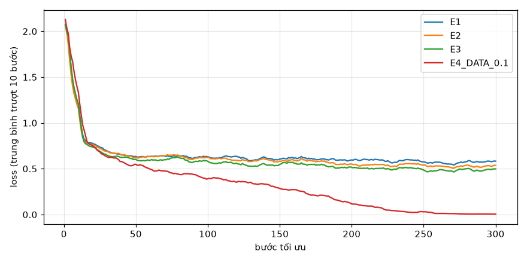
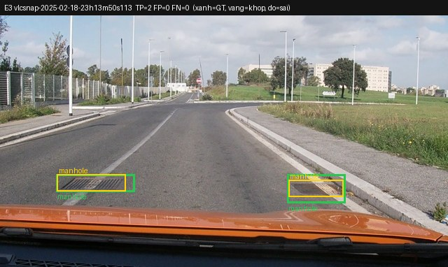
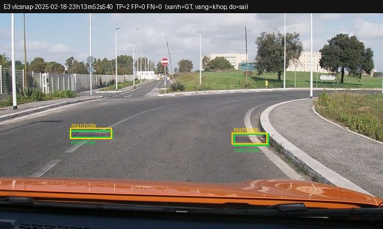
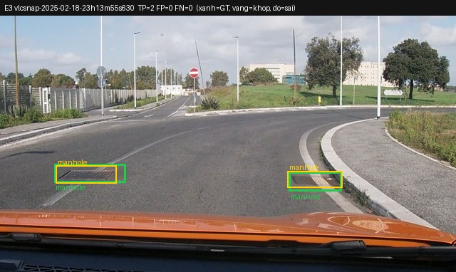
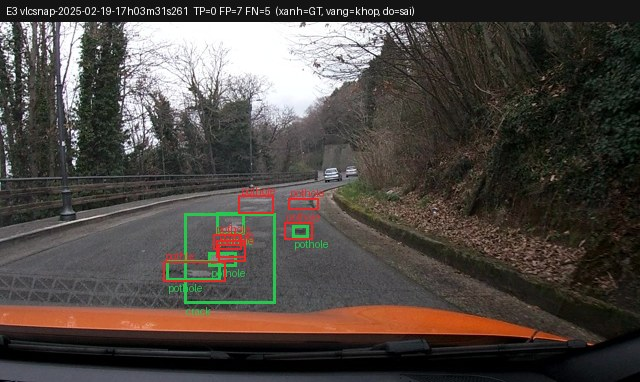
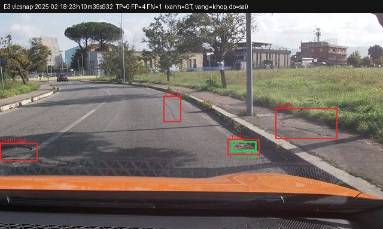
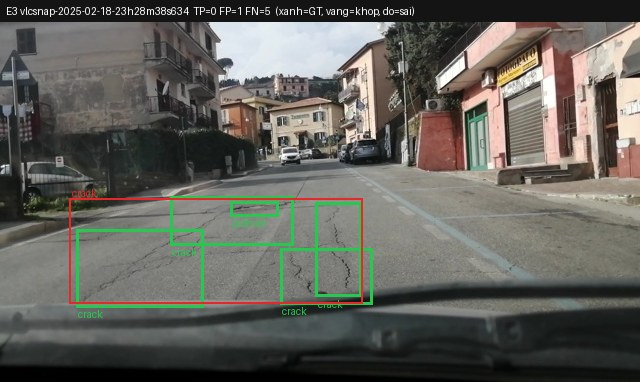
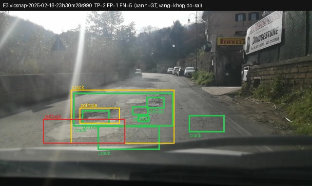
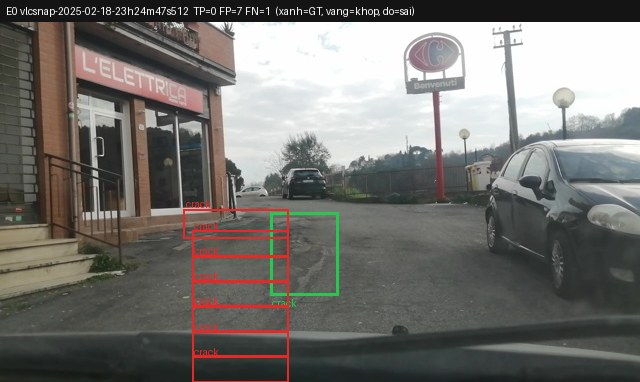
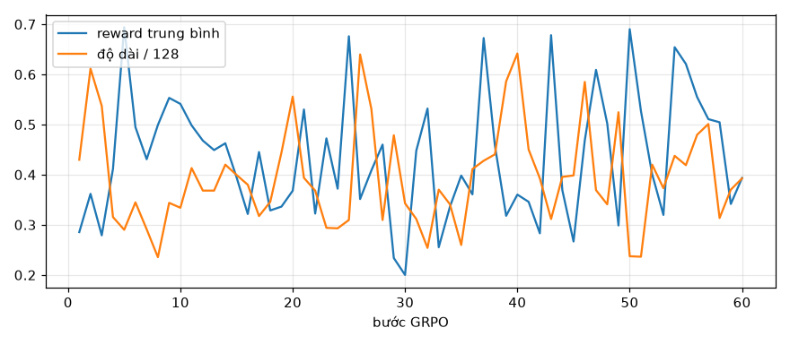

Họ tên: Hoàng Quốc Việt (2A202602563)
`dataset_version`: d10-21e4070301

> Môi trường: Kaggle, 2 GPU **Tesla T4 16 GB** (cùng loại GPU với Colab T4), torch 2.11.0+cu128, transformers 5.19.0,
> peft 0.21.2, trl 1.9.2, bitsandbytes 0.50.2 ([`report/logs/env.txt`](report/logs/env.txt)). Mỗi GPU chạy một hàng đợi
> thí nghiệm ([`kaggle/runner.py`](kaggle/runner.py)); mỗi thí nghiệm chạy trên **một** T4, nên VRAM và thời gian là của một T4.
> Mã của tôi: [`day10/`](day10/) (train, suy luận, LoRA, reward, GRPO, phân tích), notebook [`lab_day10.ipynb`](lab_day10.ipynb).
> Mọi file `report/evidence/*.json` do `scripts/score.py` của đề sinh ra tại máy từ dự đoán của Kaggle.
> Số liệu phụ (bootstrap cặp, lỗi E0, kích thước box, thang toạ độ sai): [`report/extra/analysis.json`](report/extra/analysis.json).

## Bảng tổng hợp (số của bạn, lấy từ `report/evidence/*.json`)

| Mã | Setup | Tham số huấn luyện | VRAM đỉnh (GB) | Phút | F1 | CI95 | FP/ảnh | F1 pothole | F1 crack | F1 manhole |
|---|---|---|---|---|---|---|---|---|---|---|
| E0 | zero-shot | 0 | — (không train) | — (suy luận 16,1) | 0.088 | 0.062–0.115 | 0.91 | 0.109 | 0.036 | 0.179 |
| E1 | LoRA LLM | 33,030,144 | 6.35 | 37.5 | 0.263 | 0.227–0.300 | 1.25 | 0.154 | 0.194 | 0.538 |
| E2 | + projector | 142,135,296 | 8.04 | 38.8 | 0.319 | 0.282–0.359 | 1.11 | 0.150 | 0.265 | 0.580 |
| E3 | + LoRA ViT | 148,426,752 | 8.22 | 46.4 | 0.434 | 0.394–0.475 | 0.88 | 0.262 | 0.364 | 0.708 |
| E4 | data_size = 0.1 (142 ảnh, setup E3) | 148,426,752 | 7.67 | 45.9 | 0.297 | 0.262–0.333 | 1.54 | 0.221 | 0.216 | 0.555 |
| E4 | data_size = 1.0 (= E3) | 148,426,752 | 8.22 | 46.4 | 0.434 | 0.394–0.475 | 0.88 | 0.262 | 0.364 | 0.708 |
| E5 | GRPO 60 bước từ E3 (bonus) | 39,321,600 | 5.65 | 24.0 | 0.436 | 0.394–0.476 | 0.80 | 0.284 | 0.350 | 0.718 |

VRAM là `torch.cuda.max_memory_allocated()` trong lúc train (GiB), "Phút" là thời gian vòng train 300 bước (E5: 60 bước GRPO).
`parse_valid_rate`: E0 0.839, E1 0.987, E2 1.000, E3 0.997, E4(0.1) 1.000, E5 1.000. Suy luận 311 ảnh test (batch 8,
greedy, `max_new_tokens=256`) mất 9,3–11,7 phút mỗi setup. Nhật ký: [`report/logs/`](report/logs/), đường loss:


## 10 câu hỏi (trả lời bằng **số của bạn**, không chép lại tài liệu)

### Câu 1 — Kiến trúc: ViT, projector và LLM của Qwen3-VL-4B có bao nhiêu tham số mỗi khối, và E1/E2/E3 mỗi cái cập nhật khối nào?

Tôi đếm trên chính cây module (dựng model trên thiết bị `meta` từ config thật, [`report/checks.json`](report/checks.json)):

| Khối | Module | Tham số |
|---|---|---|
| ViT (patch embed + 24 block) | `model.visual.blocks.*`, `patch_embed` | 306,242,560 |
| Projector | `model.visual.merger` | 27,271,680 |
| Projector DeepStack | `model.visual.deepstack_merger_list` (lấy đặc trưng ở block 5, 11, 17) | 81,833,472 |
| LLM | `model.language_model.*` + `lm_head` (dùng chung trọng số với embedding) | 4,022,468,096 |
| Tổng | | 4,437,815,808 |

Như vậy ViT tính cả projector ≈ 415M, projector ≈ 109,1M, LLM ≈ 4,02B. Luồng dữ liệu: ảnh → ViT (patch 16×16) → merger gộp
2×2 patch thành một token 2560 chiều (cộng thêm 3 nhánh DeepStack đưa đặc trưng tầng nông vào các lớp đầu của LLM) → LLM sinh JSON.

- **E1**: chỉ LoRA r=16 trên 252 module LLM (36 lớp × q,k,v,o,gate,up,down) = 33,030,144 tham số; ViT và projector đóng băng.
- **E2**: E1 + mở đầy đủ projector ở fp32: 33,030,144 + 109,105,152 = 142,135,296.
- **E3**: E2 + LoRA trên 96 module ViT (24 block × qkv, proj, linear_fc1, linear_fc2), thêm 6,291,456 → 148,426,752; tổng 348 module LoRA.

### Câu 2 — E0: `parse_valid_rate` bằng bao nhiêu, và hai lỗi phổ biến nhất của model gốc là gì (kèm một ví dụ output thô)?

`parse_valid_rate` của E0 = **0.839** (261/311). Model gốc không bọc markdown (0 output có ```), và đã dùng đúng thang 0–1000,
nhưng mắc hai lỗi chính:

1. **Lặp box đến khi bị cắt** (45/50 output hỏng): model sinh một chuỗi box gần như dịch đều, không đóng `]` trước 256 token, nên JSON hỏng. Ví dụ thô:
   `[{"label": "crack", "bbox_2d": [500, 350, 520, 360]}, {"label": "crack", "bbox_2d": [520, 350, 540, 360]}, {"label": "crack", "bbox_2d": [540, 350, 560, 360]}, … {"label": "crack", "bbox_2d"` (bị cắt). 5 output còn lại hỏng vì sai cú pháp, ví dụ `[287, 478, 357, 500)}]`.
2. **Bịa box / định vị sai, nhất là với `crack`**: trong output hợp lệ, precision chỉ 0.124 (40 TP / 283 FP) và recall 0.069.
   Model vẽ những dải ngang mỏng hoặc box rất to cho vết nứt (22/323 box chiếm > 25% khung hình, ví dụ `[0, 580, 1000, 700]`),
   nên F1 crack chỉ 0.036. Ngược lại, nó trả `[]` cho 16 ảnh mà ảnh nào trong tập cũng có hư hại. Manhole dễ nhất (F1 0.179) vì hình dạng rõ.

### Câu 3 — Thang 0–1000: nếu chấm output theo pixel (hoặc ngược lại) thì F1 ra sao và vì sao? Bạn đã kiểm chứng điều này thế nào?

Kiểm chứng bằng chính dự đoán E3 (F1 0.434 khi chấm đúng `--coord norm1000`), dùng `evaluate()` của `score.py`:

| Cách chấm | F1 |
|---|---|
| Output 0–1000, chấm đúng `norm1000` | 0.434 |
| Output 0–1000 nhưng chấm `--coord pixel` | **0.000** |
| Đổi output sang pixel 640×360 rồi chấm `norm1000` | **0.000** |
| Đổi output sang pixel rồi chấm `--coord pixel` | 0.431 (chỉ mất do làm tròn pixel) |

Vì sao về 0: chấm nhầm "pixel" sẽ nhân x với 1000/640 = 1,56 và y với 1000/360 = 2,78. Box bị kéo giãn và trượt xuống, nhất là
theo trục y, nên với box nhỏ (diện tích trung vị chỉ 0,4–2% khung hình) không còn box nào đạt IoU ≥ 0,5. Chiều ngược lại cũng vậy:
box co lại về góc trên trái.

Vì sao Qwen3-VL dùng 0–1000: toạ độ tương đối không phụ thuộc độ phân giải. Processor còn **đổi kích thước ảnh** trước khi vào
ViT: ảnh 640×360 của chúng ta thành lưới `image_grid_thw = [1, 22, 40]`, tức 640×352 pixel (bội số của 32 = patch 16 × gộp 2).
Nếu dùng pixel tuyệt đối, model phải đoán ảnh gốc là bao nhiêu pixel, một thông tin nó không nhìn thấy. Thang 0–1000 cũng là quy
ước model đã học khi pretrain grounding, nên E0 đã ra đúng thang ngay từ đầu. Hàm `yolo_to_box` của tôi quy ngược về pixel lệch
tối đa 0,32 px (chỉ do làm tròn) trên 3.466/3.515 box train; 49 box còn lại có nhãn gốc tràn ra ngoài khung hình vài đơn vị và bị
kẹp vào [0, 1000] (notebook mục 2).

### Câu 4 — Mask loss: vì sao chỉ tính loss trên phần trả lời? Điều gì xảy ra nếu tính trên cả prompt và token ảnh?

Trong ví dụ kiểm tra (ảnh train đầu tiên, 9 box), chuỗi dài 562 token: 220 token `<|image_pad|>`, khoảng 92 token template và
prompt, và 250 token trả lời. Tôi gán `labels = -100` cho cả 312 token đầu (ảnh + prompt). Giải mã các vị trí `labels != -100`
ra đúng chuỗi JSON đáp án cộng `<|im_end|>\n`, và tiền tố prompt khớp từng token với chuỗi đầy đủ (`encode_example` kiểm tra điều này).
Ảnh này nhiều box nên phần trả lời chiếm 44%. Với ảnh trung bình (2,4 box × ~27 token/box ≈ 70 token), phần trả lời chỉ chiếm khoảng 18% chuỗi.

Nếu tính loss trên toàn chuỗi:
- 220 vị trí ảnh có nhãn là cùng một token `<|image_pad|>`, còn prompt giống hệt nhau ở mọi mẫu. Các token này dễ đoán nên loss
  của chúng nhanh về ~0, nhưng chúng chiếm khoảng 80% số vị trí. Loss trung bình giảm trông rất đẹp, trong khi tín hiệu gradient
  cho phần toạ độ bị pha loãng khoảng 5 lần. Kết quả là học chậm hơn với cùng 300 bước.
- Model học cả việc "nói tiếp prompt": lúc suy luận dễ sinh lại câu lệnh hay văn bản thừa, làm `parse_valid_rate` giảm.
- Token ảnh không phải văn bản nên "dự đoán" chúng vô nghĩa. Cái ta cần là xác suất của JSON *khi đã có* ảnh và prompt.

(Phần này là lập luận từ cấu trúc chuỗi đã đo, tôi không chạy thêm thí nghiệm không mask.) Với mask đúng, loss của E1 giảm
từ 2,07 xuống 0,58 trong 300 bước và output hợp lệ 98,7%.

### Câu 5 — Vì sao không thể huấn luyện đầy đủ projector nếu ViT bị lượng tử hoá 4-bit, và bạn đã xử lý thế nào? Vì sao projector phải ở float32?

**Không huấn luyện đầy đủ được trên trọng số 4-bit:** `Linear4bit` của bitsandbytes lưu trọng số NF4 đã đóng gói (2 giá trị/byte,
kiểu uint8) kèm hằng số lượng tử. Đó không phải tham số liên tục nên không nhận gradient. Chỉ có thể gắn LoRA lên trên, không
cập nhật chính trọng số đó.

**Tôi đã gặp đúng lỗi này.** Với cấu hình của đề `llm_int8_skip_modules=["visual", "lm_head"]`, lần chạy thử E3 báo số tham số
projector huấn luyện là **54,579,200**, đúng một nửa của 109,105,152 vì `numel` của tensor 4-bit đóng gói bị chia đôi. Bước
`scaler.unscale_` thì dừng với `Attempting to unscale FP16 gradients`. Nguyên nhân: transformers 5.19 so khớp tên module bằng
`re.match` (khớp từ **đầu** đường dẫn) hoặc khớp đuôi, nên `"visual"` không khớp `model.visual.merger.linear_fc1` và **toàn bộ
ViT bị lượng tử hoá**. Cách xử lý:
- ghi `llm_int8_skip_modules=["visual", "model.visual", "lm_head"]`,
- thêm `assert_vit_not_quantized()` để dừng ngay nếu còn `Linear4bit` nào dưới `model.visual` hoặc ở `lm_head` ([`day10/common.py`](day10/common.py)).

Sau khi sửa, E2/E3 huấn luyện đủ **109,105,152** tham số projector. Tôi lưu riêng projector (`projector.pt`, 24 tensor) vì
`save_pretrained` của peft chỉ lưu adapter, rồi nạp lại trước khi suy luận (log `projector loaded: 24 tensors`). E2 vì thế khác
E1 thật: F1 0.319 so với 0.263.

**Vì sao fp32:**
1. **Độ chính xác cập nhật:** fp16 chỉ có 10 bit phần định trị. Bước cập nhật lr·Adam cỡ 1e-4–1e-6 so với trọng số cỡ 1e-2
   thường nhỏ hơn khoảng cách giữa hai số fp16 liền kề, nên bị làm tròn về 0 và trọng số đứng yên.
2. **Tràn số:** gradient fp16 đi qua nhiều tầng DeepStack dễ ra inf/nan. GradScaler cần gradient fp32 để unscale, và từ chối
   gradient fp16 như lỗi ở trên.
3. **Bằng chứng VRAM:** 109,1M tham số × (4 byte trọng số + 4 gradient + 8 trạng thái AdamW) = 1,75 GB = 1,63 GiB. Đo được
   E2 − E1 = 8,04 − 6,35 = 1,69 GiB, khớp gần đúng.

Phần forward vẫn chạy trong `autocast(fp16)` nên vẫn nhanh.

### Câu 6 — Split theo phiên quay: vì sao chia ngẫu nhiên sẽ cho F1 cao giả? Số ảnh và số box từng lớp ở mỗi split là bao nhiêu?

| Split | Ảnh | Phiên | pothole | crack | manhole |
|---|---|---|---|---|---|
| train | 1.422 | 13 | 1.074 | 1.750 | 691 |
| val | 276 | 2 | 66 | 470 | 103 |
| test | 311 | 3 | 121 | 299 | 163 |

Tôi đã kiểm tra: số phiên chung giữa từng cặp split = 0. Ảnh là frame cắt từ video dashcam, hai frame liền nhau (ví dụ `…18h30m17s408`
và `…18h30m20s293`) gần như cùng con đường, cùng ổ gà, cùng ánh sáng. Nếu chia ngẫu nhiên, gần như mọi ảnh test đều có một ảnh
"anh em" trong train. Model chỉ cần nhớ "ở cảnh này có ổ gà tại [x, y]" là đạt IoU cao, nên F1 đo được là khả năng **nhớ lại**,
không phải khả năng **tổng quát** sang con đường mới. Bằng chứng gián tiếp từ chính số của tôi: E4 với 142 ảnh train đưa loss
train về **0,005** (học thuộc), nhưng F1 test theo phiên chỉ 0.297. Một tập test rò rỉ sẽ thưởng chính kiểu học thuộc này.

Split theo phiên cũng có cái giá: phân bố lớp lệch (val chỉ 66 pothole) và test bị một phiên chi phối: `vlc-2025-02-18-23`
có 213/311 ảnh. Vì thế phải đọc F1 từng lớp và CI (câu 8).

### Câu 7 — So sánh E1/E2/E3: mở projector và LoRA trên ViT có đáng không (F1, CI95, VRAM, thời gian)?

| | F1 (CI95) | Hiệu so với bước trước (bootstrap cặp, CI95) | VRAM | Phút |
|---|---|---|---|---|
| E1 | 0.263 (0.227–0.300) | | 6.35 | 37.5 |
| E2 | 0.319 (0.282–0.359) | +0.056 (+0.020 … +0.094) | 8.04 (+1.69) | 38.8 (+1.3) |
| E3 | 0.434 (0.394–0.475) | +0.115 (+0.076 … +0.155) | 8.22 (+0.18) | 46.4 (+7.6) |

- **Mở projector (E2)** giúp vừa phải: +0,056 F1 (chủ yếu ở crack 0.194 → 0.265), tốn thêm 1,69 GB cho trạng thái fp32/AdamW,
  thời gian gần như không đổi.
- **LoRA ViT (E3)** đáng nhất: chỉ thêm 6,3M tham số và 0,18 GB, nhưng F1 tăng +0,115, mọi lớp đều tăng (pothole 0.150 → 0.262,
  manhole 0.580 → 0.708) và FP/ảnh giảm 1.11 → 0.88. Nó tốn thêm 7,6 phút vì gradient phải chảy ngược qua 24 block ViT
  (gradient checkpointing tính lại cả ViT). Lý do hợp lý: đặc trưng của ViT pretrain không tách tốt vết nứt và ổ gà nhỏ trên mặt
  đường dashcam; chỉnh LLM hay projector không tạo được thông tin mà ViT chưa trích ra.
- Đáng đồng tiền nhất: **E3**. Nó vẫn chạy thoải mái trên một T4 (8,2/15 GB) và cho F1 gấp 1,65 lần E1 với +29% VRAM và +24% thời gian.

### Câu 8 — Tập test có 311 ảnh: khoảng tin cậy rộng thế nào, và điều đó giới hạn kết luận so sánh các setup ra sao?

CI95 bootstrap (theo ảnh, 1000 lần) rộng 0,053 (E0) đến 0,081 (E3), tức khoảng ±0,04 quanh F1.
- **So CI riêng lẻ thì E1 và E2 chồng nhau** (0.227–0.300 và 0.282–0.359), nên nhìn bảng không thể khẳng định E2 hơn E1.
- **Bootstrap cặp** (rút cùng một tập ảnh cho cả hai setup, `day10/analysis.py`) loại bỏ độ khó riêng của từng ảnh, nên hẹp hơn.
  E2 − E1 = +0,056 (CI +0,020 … +0,094, 0,15% lần rút E2 không hơn), E3 − E2 = +0,115 (+0,076 … +0,155). Thứ tự
  E1 < E2 < E3 đứng vững trên *tập test này*. Ngược lại E5 − E3 = +0,002 (−0,020 … +0,023): không có khác biệt.

Giới hạn còn lại, và nó lớn hơn con số CI:
1. Ảnh trong cùng phiên tương quan mạnh (213/311 ảnh thuộc một phiên quay), nên 311 ảnh có ít thông tin độc lập hơn 311 mẫu thật.
   Bootstrap theo ảnh vì vậy **đánh giá thấp** độ bất định khi đem sang con đường khác.
2. Mỗi setup chỉ chạy **một seed**; độ dao động giữa các seed chưa đo.
3. Setup tốt nhất (E3) được chọn bằng F1 test, nên con số 0.434 hơi lạc quan.
4. F1 từng lớp còn kém chắc hơn: test chỉ có 121 pothole.

Kết luận đáng tin là các chênh lệch lớn (E3 hơn E1 0,17; E1 hơn E0 0,17). Chênh lệch cỡ 0,05 chỉ nên coi là gợi ý.

### Câu 9 — Phân tích lỗi theo lớp: lớp nào kém nhất và vì sao (kích thước box, số mẫu, ngữ nghĩa)? Kèm ảnh minh hoạ.

E3: pothole **0.262** (P 0.301, R 0.231) < crack 0.364 < manhole 0.708.

| Lớp | Box train | Diện tích trung vị (test) | F1 E3 |
|---|---|---|---|
| pothole | 1.074 | 0,42% khung hình | 0.262 |
| crack | 1.750 | 1,98% | 0.364 |
| manhole | 691 | 0,67% | 0.708 |

- **Pothole kém nhất vì box nhỏ nhất:** 0,42% của 640×360 ≈ 970 px², cỡ 50×19 px, nhỏ hơn một token ảnh (32×32 px sau gộp 2×2).
  Với box nhỏ như vậy, lệch vài pixel đã làm IoU < 0,5. Ổ gà còn hay nằm thành cụm nhiều cái sát nhau, nên model dễ gộp hoặc tách
  sai. Ảnh `e3_4_bad`: model đặt 7 box đúng vùng cụm ổ gà nhưng không box nào đạt IoU 0,5 (TP 0, FP 7, FN 5), và một nhãn sinh
  sai chính tả `"pothle"` nên bị tính là FP lớp `other`.
- **Crack:** nhiều mẫu nhất nhưng ranh giới mơ hồ. Một vết nứt dài có thể được gán thành 1 box hay nhiều đoạn, nên model và người
  gán nhãn khác nhau về cách chia, IoU thấp dù "thấy" đúng vết nứt.
- **Manhole tốt nhất dù ít mẫu nhất** (691): hình dạng chữ nhật/tròn, kim loại, có biên rõ. Precision 0.816.

Ảnh minh hoạ (xanh lá = nhãn đúng, vàng = dự đoán khớp IoU ≥ 0,5, đỏ = dự đoán sai):

| | |
|---|---|
|  E3 đúng: 2/2 manhole |  E3 đúng: 2/2 manhole |
|  E3 đúng: 2/2 manhole |  E3 sai: cụm pothole lệch IoU, nhãn "pothle" |
|  E3 sai: bịa 3 crack, manhole lệch |  E3 sai: bỏ sót 4 crack + pothole |
|  E3 một phần: 2 TP, 5 FN |  E0 sai: nhiều box crack bịa |

Thêm ảnh E0 trong [`report/figures/`](report/figures/) (`e0_*.jpg`), và 6 ảnh nhãn gốc: `data_samples.jpg`.

### Câu 10 — E4: bạn đổi biến nào, kết quả thế nào, và kết luận có đáng tin không?

Biến: **`data_size`**, trên setup tốt nhất E3. Giữ nguyên mọi thứ khác: r=16, lr 2e-4, 300 bước, batch 2×4, seed 42, cùng prompt
và thang 0–1000. Tập 10% là 142 ảnh rút cố định (seed 42). Giá trị 1.0 chính là E3, dùng lại dự đoán của E3, như GUIDE cho phép.

| data_size | Ảnh | F1 (CI95) | P / R | FP/ảnh | Loss train cuối |
|---|---|---|---|---|---|
| 0.1 | 142 | 0.297 (0.262–0.333) | 0.279 / 0.317 | 1.54 | 0.005 |
| 1.0 | 1.422 | 0.434 (0.394–0.475) | 0.464 / 0.408 | 0.88 | 0.498 |

Với cùng 300 bước, 142 ảnh được xem khoảng 17 lần mỗi ảnh. Loss train về 0,005 (học thuộc), recall vẫn ổn (0.317) nhưng
precision sụp (FP/ảnh 1.54): model sinh box theo khuôn những cảnh đã nhớ. **Kết luận đáng tin về chiều**: hai CI95 không chồng
nhau, và bootstrap cặp cho hiệu +0,138 (CI +0,097 … +0,175). Về **độ lớn** thì nên dè dặt: (a) biến thật sự là "số ảnh khác nhau
với cùng ngân sách tính toán", nên 10% dữ liệu ít bước hơn có thể bớt học thuộc; (b) một seed và một tập con duy nhất;
(c) cả hai bị giới hạn bởi tập test nhiều tương quan như câu 8.

## E5 (bonus): GRPO với reward IoU

- **Reward** ([`day10/reward.py`](day10/reward.py)): parse hỏng → 0; cả hai rỗng → 1; ngược lại `0.2 + 0.8·ΣIoU/max(n_gt, n_pred, 1)`,
  ghép tham lam cùng lớp với IoU ≥ 0,5, dùng chung `parse_output` và `iou_xyxy` với trọng tài.
  [`day10/tests/test_reward.py`](day10/tests/test_reward.py) có 10 test và đều pass: hoàn hảo 1.0, JSON hỏng 0.0, sai lớp 0.2,
  thừa box 0.6, cùng rỗng 1.0, `[]` trên ảnh có hư hại 0.2, box khổng lồ 0.2, lệch nửa phần 0.733, bọc markdown, quy đổi nhãn.
- **Chạy** ([`day10/grpo.py`](day10/grpo.py)): `trl.GRPOTrainer` 1.9.2, khởi tạo từ adapter + projector của E3. Projector đóng
  băng, LoRA LLM + ViT huấn luyện (39,321,600 tham số). `num_generations=4`, 2 ảnh/bước, `max_completion_length=128`, lr 5e-6,
  β=0, 60 bước, 24,0 phút, VRAM 5,65 GB. Tôi chỉ dùng 1.280/1.422 ảnh train có đáp án vừa 128 token. Nếu không lọc, đáp án đúng
  cũng bị cắt thành JSON hỏng (reward 0), và GRPO sẽ học cách trả ít box. TRL tự đưa LoRA về bf16 cho model lượng tử hoá; T4 không
  có bf16, nên tôi đưa lại fp32 và chạy fp16 + GradScaler. Log: [`report/logs/e5_log_history.json`](report/logs/e5_log_history.json),
  [`e5_reward_log.jsonl`](report/logs/e5_reward_log.jsonl). 
- **Reward hacking?** Không thấy. Theo từng cửa sổ 10 bước: tỉ lệ trả `[]` = 0 ở mọi cửa sổ; box khổng lồ (> 25% khung hình)
  5 → 0 → 0 → 0 → 1 → 1 trên 80 completion mỗi cửa sổ; JSON hợp lệ 0,95 → 1,00. Có một xu hướng **thận trọng**: số box dự đoán
  trung bình ít hơn GT khoảng 0,35 box/ảnh. Mẫu số `max(n_gt, n_pred)` phạt box thừa và box thiếu như nhau, nên khi không chắc,
  bỏ một box mơ hồ là lựa chọn an toàn. Reward trung bình 10 bước đầu 0,455, 10 bước cuối 0,483, dao động rất mạnh giữa các bước
  (0,29–0,68) vì mỗi bước chỉ có 2 ảnh.
- **So với SFT (E3), cùng tập test:** precision 0.464 → 0.482, FP/ảnh 0.88 → 0.80, recall 0.408 → 0.398, F1 0.434 → 0.436.
  Hiệu F1 bootstrap cặp = +0,002 (CI −0,020 … +0,023), nên **không vượt CI95**: 60 bước × 2 ảnh với lr 5e-6 chỉ dịch model
  một chút về phía ít box hơn và chính xác hơn, chưa đủ để nói GRPO cải thiện F1.

## Nhìn lại

- **Bẫy lớn nhất không có công cụ nào bắt:** cấu hình skip `["visual", "lm_head"]` của đề không có tác dụng với transformers 5.19,
  và model vẫn chạy, vẫn sinh JSON. Nếu không đếm tham số projector (54,6M thay vì 109,1M) thì E2/E3 sẽ "huấn luyện" một projector
  4-bit. `check_submission.py` và `score.py` không thể phát hiện điều này; tôi thêm assert ngay khi nạp model.
- GUIDE ghi patch 14×14; Qwen3-VL-4B thực tế dùng patch 16, nên 640×360 được đổi kích thước thành 640×352 (lưới 22×40) và
  ra đúng 220 token sau gộp 2×2.
- `score.py` coi nhãn sai chính tả (`"pothle"`) là FP lớp `other`, đúng về chấm điểm nhưng giấu lỗi sinh token. Nên thêm thống kê
  nhãn lạ vào báo cáo của trọng tài.
- `max_new_tokens=256` đủ cho test (tối đa 7 box ≈ 190 token), nhưng ảnh train dày nhất có 13 box ≈ 350 token: trên dữ liệu dày
  hơn, giới hạn này sẽ cắt JSON. Lỗi chính của E0 (45/50 output hỏng) chính là vòng lặp box bị cắt ở 256 token.
- Kaggle có sẵn `torchao` 0.10 làm peft lỗi khi gắn LoRA vào `nn.Linear` fp16 của ViT; phải gỡ nó trước E3.
- Điều tôi chưa đo: độ dao động giữa các seed, và thí nghiệm không mask loss (câu 4 là lập luận). Với split theo phiên, tập test
  3 phiên vẫn là giới hạn lớn nhất của mọi kết luận.
